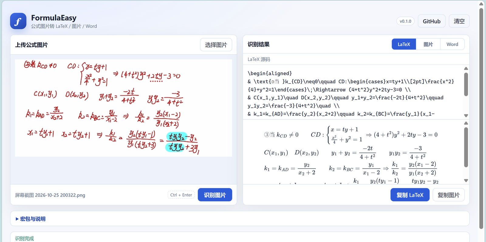
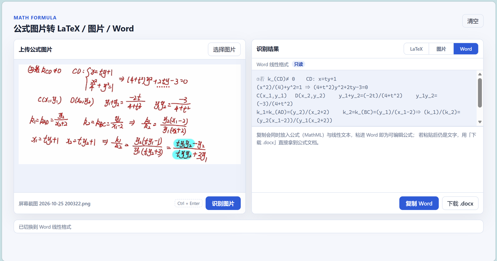
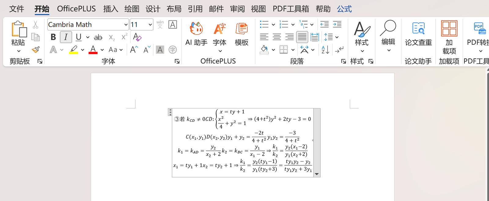
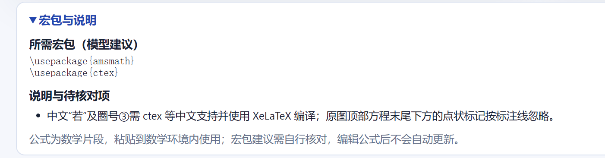

# FormulaEasy

**English** · [简体中文](README.zh-CN.md)

Formula image to LaTeX / PNG / Word web tool. Runs locally, with your own
OpenAI-compatible vision model.



## Features

- **Editable source with live preview** — every keystroke re-renders through
  MathJax; the same rendering is the source for PNG export.
- **Three output targets** — LaTeX, image, or Word, chosen in the result panel.
  The copy button follows the selected target.
- **Word that is really an equation** — MathML goes on the clipboard, and a
  `.docx` with real OMML equations can be downloaded.
- **Structure preserved** — line breaks, `aligned` blocks, and Chinese labels
  survive; ragged alignment columns are rewritten to a shared left edge.
- **Compile-ready output** — the API returns `packages` and `notes`, so the
  result compiles with the packages it names.
- **Local and model-agnostic** — one Node process, any OpenAI-compatible vision
  model, no image leaves the machine.

### Output targets

| Target | You get | How |
| --- | --- | --- |
| LaTeX | editable, compile-ready source | edit in place, then copy |
| Image | white-background PNG at 3× scale | copy to clipboard or download |
| Word | editable equation object | MathML clipboard, or `.docx` download |



### Word output



### Packages and notes



## Run

```powershell
npm install
copy .env.example .env
npm start
```

Open:

```text
http://localhost:3002
```

`PORT` comes from `.env` and defaults to `3000` when unset.

## OCR configuration

```env
OCR_PROVIDER=api
OPENAI_API_KEY=your_key
OPENAI_BASE_URL=https://dashscope.aliyuncs.com/compatible-mode/v1
OCR_MODEL=qwen-vl-plus
```

## Security

Never commit `.env`. Use `.env.example` for public configuration samples.

## Recognition output

The API returns `latex`, `word`, `result`, plus `packages` (package names) and
`notes` (compilation advice and recognition uncertainties). Older responses with
only `latex` and plain LaTeX responses remain supported, with empty metadata.
Package suggestions are model-generated and should be checked before use.

LaTeX output is a math fragment without outer math delimiters. Put it inside a
math environment in your document. The prompt asks the model to preserve reading
order, equation groups and source line breaks rather than redesign the layout.
This improves instructions but does not guarantee recognition accuracy.

The image panel scrolls independently to show long images at a readable width.
The result is editable source text; no formula rendering or TeX compiler is added.
LaTeX metadata is shown separately and is not included when copying the formula.

## Typesetting notes

The returned value is a math fragment, so it has to sit inside a math environment
(`\[ ... \]`, `equation`, `align`, ...). The server normalizes the cases it can
prove: `\&` inside `aligned`/`cases`/`matrix` becomes `&`, and a fragment that
contains `&` without any alignment environment is wrapped in `aligned`.

## License and credits

Released under the ISC license, see [LICENSE](LICENSE).

This project is based on
[hitszHugh/Math-Formula-Picture-to-LaTex-or-Word-Default-Format-Web](https://github.com/hitszHugh/Math-Formula-Picture-to-LaTex-or-Word-Default-Format-Web),
whose history starts from blueRita's original implementation. Copyright in the
original work remains with its author.

Changes made in this fork:

- MathJax rendering, live preview, and PNG export via canvas
- Word output rewritten to UnicodeMath, plus MathML clipboard and `.docx` export
- LaTeX normalization: alignment environments, `\textcircled`, spacing commands,
  ragged `aligned` blocks, differential spacing
- Scenario-based test suite (`npm test`, `npm run test:tex`)
- English and Simplified Chinese READMEs
