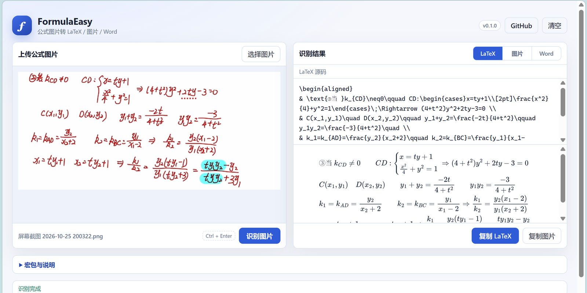
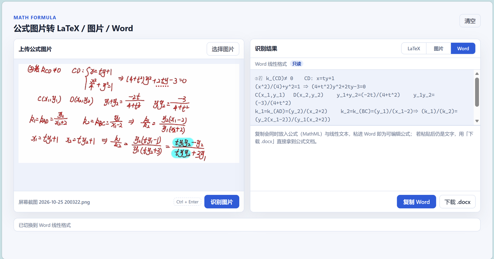
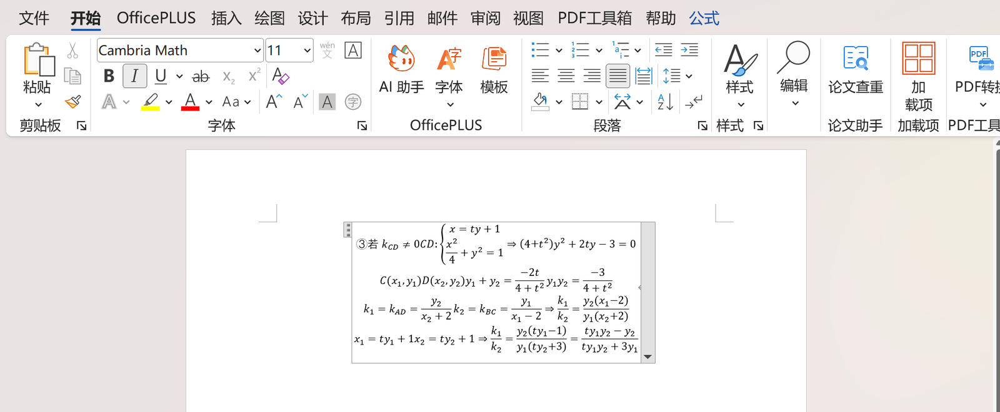
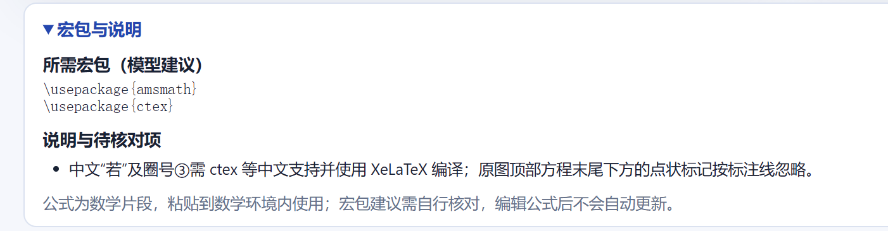

# FormulaEasy

[English](README.md) · **简体中文**

本地运行的公式 OCR 工具：图片进，可编辑的 LaTeX、PNG 图片或 Word 公式出。
模型走你自己的 OpenAI 兼容接口。



## 主要功能

- **可编辑源码 + 实时预览**：每敲一个字符都会用 MathJax 重新渲染，同一份渲染结果也是导出 PNG 的来源。
- **三种输出**：在结果面板里选择 LaTeX、图片或 Word，复制按钮会跟着目标变化。
- **真正是公式的 Word**：复制时把 MathML 放进剪贴板，也可以下载带 OMML 公式的 `.docx`。
- **保留结构**：换行、`aligned` 分组、中文标注都会保留；参差的对齐列会被改写成共享左边界。
- **可直接编译**：接口返回 `packages` 与 `notes`，按它声明的宏包即可编译。
- **本地运行、模型可换**：一个 Node 进程，任何 OpenAI 兼容的视觉模型，图片不出本机。

### 输出方式

| 目标 | 得到什么 | 怎么用 |
| --- | --- | --- |
| LaTeX | 可编辑、可直接编译的源码 | 就地修改后复制 |
| 图片 | 3 倍分辨率白底 PNG | 复制到剪贴板或下载 |
| Word | 可编辑的公式对象 | MathML 剪贴板，或下载 `.docx` |



### Word 输出



### 宏包与说明



## 运行

```powershell
npm install
copy .env.example .env
npm start
```

打开：

```text
http://localhost:3002
```

`PORT` 从 `.env` 读取，未设置时默认 `3000`。

## OCR 配置

```env
OCR_PROVIDER=api
OPENAI_API_KEY=your_key
OPENAI_BASE_URL=https://dashscope.aliyuncs.com/compatible-mode/v1
OCR_MODEL=qwen-vl-plus
```

## 安全

不要把 `.env` 提交到仓库。公开配置示例请用 `.env.example`。

## 识别输出

接口返回 `latex`、`word`、`result`，以及 `packages`（宏包名）和 `notes`
（编译建议与识别不确定项）。只返回 `latex` 的旧响应仍然兼容，元数据为空。
宏包建议由模型生成，使用前请自行核对。

LaTeX 输出是不带外层定界符的数学片段，需要放进文档的数学环境里。Prompt 要求
模型保留阅读顺序、公式分组与源码换行，而不是重新设计版面。这能改善指令遵循，
但不保证识别准确率。

图片面板可独立滚动，长图也能以可读宽度查看。结果是可编辑的源码文本；本项目不
提供公式渲染器之外的 TeX 编译器。LaTeX 元数据单独展示，复制公式时不会带出。

## 排版说明

返回值是数学片段，必须放在数学环境里（`\[ ... \]`、`equation`、`align` 等）。
服务端会归一化它能证明的情况：`aligned`/`cases`/`matrix` 里的 `\&` 还原成 `&`；
含 `&` 但没有任何对齐环境的片段会被包上一层 `aligned`。

## 许可与致谢

以 ISC 许可发布，见 [LICENSE](LICENSE)。

本项目基于
[blueRita/Math-Formula-Picture-to-LaTex-or-Word-Default-Format-Web](https://github.com/blueRita/Math-Formula-Picture-to-LaTex-or-Word-Default-Format-Web)。
原始作品的著作权仍归其作者所有。

本 fork 的改动：

- MathJax 渲染、实时预览、canvas 导出 PNG
- Word 输出改写为 UnicodeMath，并增加 MathML 剪贴板与 `.docx` 导出
- LaTeX 归一化：对齐环境、`\textcircled`、间距命令、参差 `aligned`、微分间距
- 按场景组织的测试（`npm test`、`npm run test:tex`）
- 英文与简体中文两版 README
